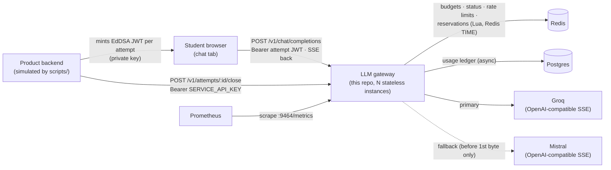
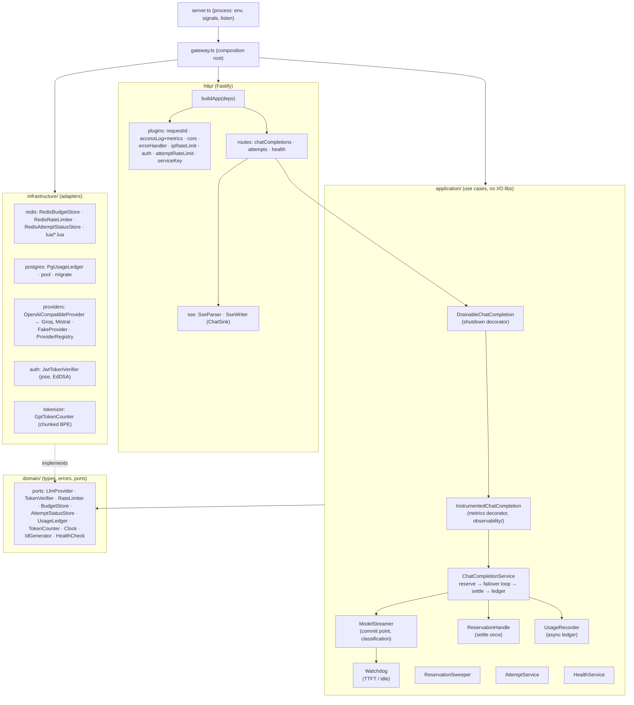
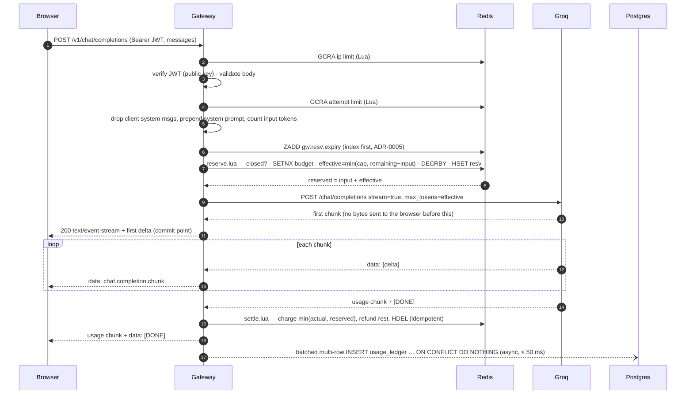
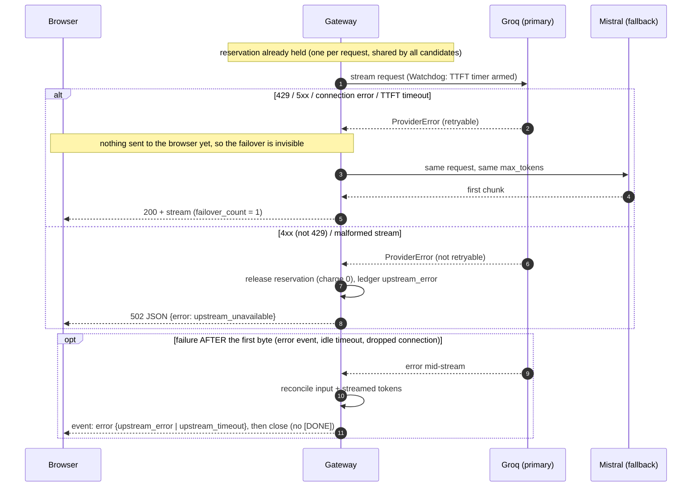
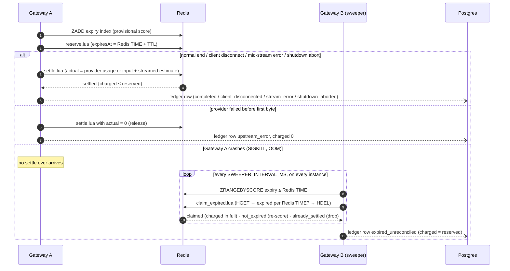

# Architecture

How the gateway is built and why. Requirements: [SPEC.md](SPEC.md). Decisions: [adr/](adr/README.md).

## 1. Context

The gateway holds only the JWT **public** key and the provider API keys. Students never see
provider keys or choose models. Every instance is identical and stateless; all shared state is in
Redis (authoritative) and Postgres (audit).

## 2. Components and layers

**Dependency rule** (enforced by ESLint `no-restricted-imports`): `domain` ← `application` ←
`infrastructure` / `http` / `observability` ← `gateway.ts` ← `server.ts`. The core never imports
Fastify, ioredis, pg, jose, pino or prom-client.

| SOLID | where it shows                                                                                                                                                                                            |
| ----- | --------------------------------------------------------------------------------------------------------------------------------------------------------------------------------------------------------- |
| SRP   | the route handler only builds the sink and calls the use case; streaming one model (`ModelStreamer`), timeouts (`Watchdog`), settle-once (`ReservationHandle`), ledger I/O (`UsageRecorder`) are separate |
| OCP   | a new vendor = an adapter subclass + one `ProviderRegistry` factory line; metrics and shutdown added as decorators without touching the service                                                           |
| LSP   | one contract suite (`test/contract/providerContract.ts`) runs against every adapter, including the fake, with identical error classification                                                              |
| ISP   | each Redis store implements one small port; there is no "RedisService"                                                                                                                                    |
| DIP   | `application` depends on `domain/ports.ts`; `buildApp(deps)` and `createGateway()` inject implementations; tests inject in-memory fakes                                                                   |

## 3. Request pipeline

| #   | step                                                    | where                                                    | rejects with                            |
| --- | ------------------------------------------------------- | -------------------------------------------------------- | --------------------------------------- |
| 1   | request id (server-generated, ADR-0014)                 | `genReqId` + `requestId` hook                            | —                                       |
| 2   | per-IP rate limit (GCRA)                                | `onRequest` (chat scope)                                 | 429 + Retry-After                       |
| 3   | auth: EdDSA signature, `aud`, `exp`, claim shapes       | `onRequest`                                              | 401                                     |
| 4   | validation: ≤ 256 KB, ≤ 100 msgs, ≤ 32 000 chars, roles | Fastify `bodyLimit` + zod schema                         | 400                                     |
| 5   | per-attempt rate limit (GCRA)                           | `preHandler`                                             | 429 + Retry-After                       |
| 6   | reserve (Lua)                                           | first I/O of `ChatCompletionService.complete` (ADR-0004) | 403 closed / 403 budget_exhausted / 503 |
| 7   | stream with failover, reconcile, ledger                 | `ChatCompletionService`                                  | 502 before first byte / SSE error after |

The pairwise ordering is tested in `test/unit/http/pipeline.test.ts`.

## 4. Happy path

## 5. Failover (FR6, ADR-0017)

## 6. Budget: reserve, reconcile, and crash recovery

**Invariant**: `remaining + Σ open reservations + Σ charged = initial budget`, and `remaining ≥ 0`
at every instant. Three things guarantee it:

- reserve subtracts only what it has checked is available, atomically in Lua;
- settle and claim each delete the reservation in the same atomic step as the refund or charge,
  so each reservation is settled exactly once;
- the provider is called with `max_tokens = effective`.

Proven by `test/concurrency/` (100 parallel reserves, a 200-operation seeded storm with a live
sampler, 60 parallel HTTP chats on one attempt).

## 7. Redis data model

| key                    | type   | content                                                                                      |
| ---------------------- | ------ | -------------------------------------------------------------------------------------------- |
| `gw:{att:<id>}:budget` | string | remaining tokens (after open reservations)                                                   |
| `gw:{att:<id>}:status` | string | `closed` or absent                                                                           |
| `gw:{att:<id>}:resv`   | hash   | reservationId → JSON `{r reserved, i input, e expiresAt, c createdAt, s student, q request}` |
| `gw:{att:<id>}:rl`     | string | GCRA theoretical arrival time (per attempt)                                                  |
| `gw:rl:ip:<ip>`        | string | GCRA theoretical arrival time (per IP)                                                       |
| `gw:resv:expiry`       | zset   | member = attempt id and reservation id joined by a pipe; score = provisional expiry          |

The `{att:<id>}` hash tag puts an attempt's keys in one cluster slot, so a per-attempt Lua script is
cluster-safe. Every cross-instance time decision uses Redis `TIME` (ADR-0003). Redis must run with
`noeviction` and AOF (ADR-0016): an evicted budget would be re-initialised as a fresh allowance.

## 8. Error taxonomy

| class                        | status | code                   | when                                                    |
| ---------------------------- | ------ | ---------------------- | ------------------------------------------------------- |
| `ValidationError`            | 400    | `invalid_request`      | schema, body size, malformed JSON, only-system messages |
| `UnauthorizedError`          | 401    | `unauthorized`         | missing/invalid/expired JWT, bad service key            |
| `AttemptClosedError`         | 403    | `attempt_closed`       | reserve on a closed attempt                             |
| `BudgetExhaustedError`       | 403    | `budget_exhausted`     | effective completion ≤ minimum (ADR-0006)               |
| `RateLimitedError`           | 429    | `rate_limited`         | GCRA limit, with Retry-After                            |
| `UpstreamUnavailableError`   | 502    | `upstream_unavailable` | no candidate produced output                            |
| `DependencyUnavailableError` | 503    | `service_unavailable`  | Redis down (fail closed), Retry-After                   |
| `ShuttingDownError`          | 503    | `shutting_down`        | draining instance, Retry-After                          |
| anything else                | 500    | `internal_error`       | a bug (full error logged)                               |

Clients always get `{error: {code, message}, request_id}` with a generic message. Details go to
the logs, correlated by `request_id`. Provider failures are a separate internal taxonomy
(`ProviderError.kind`) that drives failover; it never reaches clients directly.

## 9. Observability

- **Logs**: pino JSON, one line per event, `request_id` on every request-scoped line,
  `attempt_id` after auth. Access log per request (499 for client aborts, including hijacked
  SSE). `chat completion finished` with outcome, provider, tokens, TTFT, latency and failovers.
  **Never content**: no code path logs bodies; error summaries drop third-party messages
  (`safeError`); redaction paths are a second line of defence; an e2e test greps every log line
  for prompt and completion sentinels.
- **Metrics** (`:9464/metrics`, not on the public port): HTTP requests/duration by route
  template, chat outcomes, active streams, TTFT histogram, tokens charged, failovers by reason,
  provider requests by result and first-chunk latency, ledger write failures, sweeper claims and
  errors, process metrics and event-loop lag.

## 10. Deployment shape

- One image (`Dockerfile`, multi-stage, non-root, healthcheck) runs both the gateway and
  migrations (`node dist/migrate.js`).
- Horizontally scalable: no instance-local state except in-flight streams.
- Orchestrator: readiness = `/readyz`, liveness = `/healthz`, termination grace >
  `SHUTDOWN_DRAIN_TIMEOUT_MS`, `/metrics` on an internal port.
- CI (`.github/workflows/ci.yml`): lint → format → typecheck → build → all tests with coverage
  against service containers, plus a production-image smoke job. CD (`cd.yml`): build + push to
  GHCR, Trivy scan, deploy **stubbed**.
